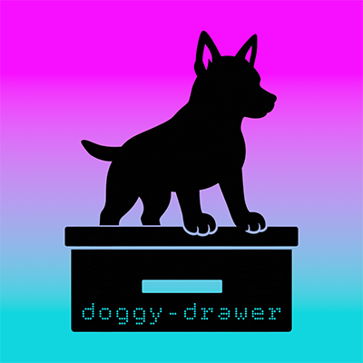

<p align="center">
  
</p>

<h1 align="center">doggy-drawer</h1>

<p align="center">
  <strong>A little drawer for a lot of Puppy commands.</strong><br>
  A read-only command companion for Code Puppy, right beside your chat in herdr.
</p>

<p align="center">
  <a href="https://github.com/herdrdev/herdr">herdr</a> ·
  <a href="#quick-start">Quick start</a> ·
  <a href="#discovery-modes">Discovery</a> ·
  <a href="#controls">Controls</a> ·
  <a href="#development">Development</a>
</p>

---

Keep your conversation open. Browse commands in their own pane. Find the thing
without accidentally running the thing.

**doggy-drawer** is a [Textual](https://textual.textualize.io/) inspector for
Code Puppy commands, designed for a right-hand
[herdr](https://github.com/herdrdev/herdr) split. It is a companion pane—not a
replacement chat, command launcher, or fork of herdr's sidebar.

## What's in the drawer?

- **Searchable command tree** with compact expand-all and collapse-all controls.
- **Command details** with available descriptions, usage, and source metadata.
- **Dashboard, /CMD, and Settings tabs**, with persistent tab ordering.
- **Category policies:** Drawer-first workflow groups or Puppy-first native
  categories, plus per-command overrides.
- **Independent scrolling** for command details and the command list.
- **Snapshot isolation:** the UI consumes JSON without importing Puppy.
- **Home-path abbreviation:** displayed home paths use `%USERPROFILE%`; stored
  metadata and filesystem paths stay unchanged.

> **Read-only means read-only.** Selecting a command, pressing Enter, or
> double-clicking a row never executes it. The inspector has no command dispatch,
> shell execution, agent input, or herdr transport. The optional bridge handles
> discovery and pane setup separately.

## Quick start

Requires Python 3.11+ and [uv](https://docs.astral.sh/uv/).

```sh
uv sync --frozen
uv run --frozen doggy-drawer --check
uv run --frozen doggy-drawer
```

Auto-discovery checks the current Python environment and common uv tool locations.
For a different installation, supply directories explicitly (repeatable):

```sh
uv run --frozen doggy-drawer --source /path/to/site-packages/code_puppy/command_line
```

**Catalog scope:** the scanner reads Python files and extracts literal
`@register_command(...)` metadata using the AST. It never imports Puppy, invokes
handlers, or runs plugin help callbacks. It includes core-plugin decorators when
found by auto-discovery. Dynamic registrations, callback-advertised commands,
user plugins elsewhere, and nonliteral metadata may be missing. Declarations can
also belong to inactive plugins. This is **not a runtime capability manifest**.
Source paths/lines and missing detailed help are displayed explicitly. Duplicate
names keep the first declaration and create a scan notice. `--check` prints notices.

## Discovery modes

| Mode | Command source | Refresh behavior |
| --- | --- | --- |
| Static fallback | Literal command decorators parsed from Python source | Standalone app startup |
| One-time picker export | Registration and completion discovery in a separate Puppy process | Rerun the exporter |
| Optional live bridge | Picker in the Puppy process that loads the bridge | Startup, input-ready events, explicit refresh |

**Status:** the one-time discovery pane has been exercised locally. The live
bridge is implemented and unit-tested, but its full lifecycle has **not yet been
verified end-to-end in the running chat**. Installation does not attach it to an
already-running Puppy session.

### Optional Puppy bridge

The standalone launch above is deliberately a **partial static fallback**, not
Puppy's complete command list. For the live picker, install the bridge from this
project's isolated environment:

```sh
uv run --frozen doggy-drawer install-plugin
```

After installation, restart Puppy when convenient, then run `/drawer enable`.
The bridge is designed to export `SlashCompleter` results (including aliases and
plugin-advertised commands), refresh at input-ready lifecycle events, and open a
read-only pane. Installation copies a user plugin; it does not install packages
in Puppy's venv. Keep the checkout available for the isolated UI runtime.

Bridge commands are entered in **Puppy**, not executed from the drawer:

```text
/drawer refresh
/drawer category mode drawer
/drawer category mode puppy
/drawer category set COMMAND CATEGORY
/drawer category reset COMMAND
/drawer category list
/drawer tabs dashboard commands settings
```

Configuration and preferences live under
`%USERPROFILE%\.code_puppy\doggy-drawer\`.

### One-time discovery, without restarting chat

For a one-time full discovery without restarting the current chat, run the
following **with Puppy's interpreter**, with this project's `src` on `PYTHONPATH`:

```sh
python -m doggy_drawer.picker_export --output /path/to/catalog.json
```

Then launch the isolated UI with `--snapshot /path/to/catalog.json`. This runs
normal command registration and completion/help discovery, never command handlers
or lifecycle startup. It is explicitly labeled **one-time discovery, not the
active chat's live session**. Session-specific plugins/state may differ; rerun the
export after installation changes. The UI itself never imports Puppy.

### What actually calls Puppy?

```text
Puppy exporter / optional in-process bridge
  → SlashCompleter.get_completions(...)
  → command_registry.get_unique_commands() for category enrichment
  → JSON snapshot
  → isolated Textual UI
```

The UI polls its snapshot every second. Searching, selecting, grouping, switching
tabs, and displaying details happen locally. The bridge's 20-second heartbeat
republishes cached rows; it does **not** rediscover commands. Discovery happens at
startup, input-ready lifecycle events, or `/drawer refresh`.

Updating Puppy does not refresh a one-time export. Rerun the exporter, or load and
enable the bridge in the relevant Puppy process. Registration and plugin help
providers may run during discovery; slash-command handlers do not. Help providers
are not guaranteed side-effect-free. Picker metadata is not a complete argument
reference or a target capability manifest.

## Controls

- Type in search to filter names, aliases, categories, and descriptions.
- `Enter` in search or `Esc`: focus the command list.
- `Up` / `Down` in the list: select a command and update its details.
- Click a row to select it. Enter and double-click **do not execute anything**.
- `F2`: focus details; arrow keys and Page Up/Down scroll that region.
- `Ctrl+F`: return to search. `Tab` / `Shift+Tab`: cycle focus.
- `Ctrl+Q`: close the inspector only.
- Details and list have separate scroll regions; focus does not follow hover.

Herdr owns pane-to-pane focus and its outer sidebar. Mouse forwarding depends on
the host terminal/herdr configuration and needs a real Windows session check;
headless tests alone cannot certify that path. Use herdr's configured focus keys
to return to chat. A narrow companion will wrap details; enlarge the pane if needed.

## Herdr plugin

Installed herdr 0.9.5 advertises plugin panes with right/down split placement.
The manifest has no startup hooks or actions. Linking is opt-in and creates a
persistent plugin registration; opening creates a terminal pane. From the repo:

```sh
herdr plugin link .
herdr plugin pane open --plugin doggy-drawer --entrypoint inspector --placement split --direction right --target-pane YOUR_CHAT_PANE --no-focus
```

Replace `YOUR_CHAT_PANE` with the verified chat pane ID; don't infer it from focus.
Herdr defaults plugin command cwd to the plugin root; if overriding cwd, pass this
repository directory. `uv` must be on herdr's PATH. `uv sync --frozen` first avoids
dependency setup on the first pane launch. Split sizing belongs to herdr; upstream
split code uses an initial 50/50 ratio, not the manifest's popup width settings.
Resize using herdr's own controls. This is a plugin-owned pane, **not a sidebar fork**.

Rollback: close the inspector using `Ctrl+Q` or
`herdr plugin pane close PANE_ID`, then `herdr plugin unlink doggy-drawer`.
No existing chat pane is closed or replaced. Restoration/relaunch after a herdr
restart is not yet verified; do not assume the app will be resurrected automatically.

## Known limitations

- Early prototype: future Puppy registry and callback compatibility is not guaranteed.
- A one-time export can differ from the plugins and state of your active chat.
- Polling does not make a snapshot live. Live-origin snapshots warn after 90 seconds
  without an update; discovery exports are labeled non-live.
- The bridge uses a shared herdr plugin ID; concurrent-session relinking needs
  further validation.
- The manifest advertises Windows, Linux, and macOS; this is not a claim of
  end-to-end validation on all three platforms.
- Detailed help may be missing. Source/declaration metadata describes provenance,
  not a fully resolved handler definition.

## Development

```sh
uv sync --frozen --group dev
uv run --frozen pytest
uv run --frozen ruff check .
uv run --frozen ruff format --check .
```

Tests cover safe source parsing, filtering, empty/error cases, mouse selection,
keyboard focus, scrolling, and small viewport behavior. No execution support is
planned for this prototype. Future dispatch requires explicit target identity,
editor readiness, authorization, and delivery/result semantics; terminal writes
are not structured command completion acknowledgements.

## License

[MIT](LICENSE). Built to sit beside Puppy, not get between you and your chat.
